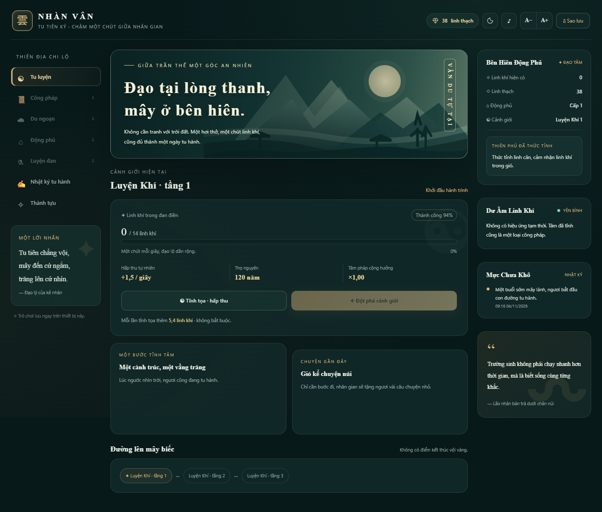

# ☁ Nhàn Vân Tu Tiên Ký

> Game tu tiên **idle / incremental** dành cho một người chơi. Không thi đua, không hết giờ, không có thua cuộc — chỉ cần mở lên, ngắm mây và để linh khí tự tích lũy.



## Chơi ngay

**Cách đơn giản nhất:** mở `index.html` bằng Chrome, Edge, Firefox hoặc Safari. Không cần cài Node.js, framework, database hay chạy build.

Có thể mở bằng VS Code cùng extension **Live Server** nếu muốn tự động tải lại khi đang sửa code, nhưng đây **không phải yêu cầu** để chơi.

> Font Google được tải khi có Internet. Nếu ngoại tuyến, trình duyệt dùng font dự phòng; toàn bộ cơ chế chơi vẫn hoạt động.

## Tính năng

- Linh khí tự tăng theo thời gian, tĩnh tọa để tăng thêm tùy thích.
- Hệ thống cảnh giới từ **Luyện Khí (9 tầng)** đến **Phi Thăng**, đột phá có tỉ lệ thành công cao.
- Tích lũy linh khí khi đóng game, tối đa **8 giờ**.
- Công pháp phẩm **Hoàng / Huyền / Địa / Thiên**, linh thạch, động phủ, trồng linh thảo.
- Đan dược luyện theo thời gian thực, hiệu ứng tăng hấp thu và hỗ trợ đột phá.
- **36 sự kiện** du ngoạn, **26 thành tựu** và nhật ký tu hành.
- Hiệu ứng thiên kiếp nhẹ nhàng, nền linh khí, âm thanh Web Audio tùy chọn.
- Giao diện tiếng Việt, tương thích điện thoại và máy tính, có chế độ sáng/tối và chỉnh cỡ chữ.
- Tự lưu bằng `localStorage` mỗi 10 giây và khi đóng tab, hỗ trợ **xuất/nhập Base64**.

## Cấu trúc thư mục

```text
nhan-van-tu-tien-ky/
├── index.html                  # Toàn bộ HTML + CSS + JavaScript của game
├── README.md                   # Giới thiệu, chạy game, hướng dẫn Git
├── .gitignore                  # Loại bỏ tệp tạm / bản sao tiến độ
├── .editorconfig               # Quy ước định dạng khi cùng phát triển
├── .gitattributes              # Chuẩn hóa dấu xuống dòng trên Git
├── .nojekyll                   # Phục vụ tệp tĩnh trên GitHub Pages
├── TESTING.md                  # Kết quả kiểm tra và giới hạn kiểm thử
└── assets/
    ├── preview-desktop.png     # Ảnh xem trước trên máy tính
    └── preview-mobile.png      # Ảnh xem trước trên điện thoại
```

**Kiến trúc:** game thuần front-end, không có server, API, database hay thư viện JavaScript bên ngoài. `index.html` đã chứa toàn bộ CSS, cấu hình, logic và giao diện để có thể chạy độc lập.

## Nơi chỉnh sửa game

Mở `index.html` và tìm các khu vực:

| Thành phần | Mục đích |
| --- | --- |
| `<style>` | Giao diện, màu sắc và hiệu ứng; đổi theme qua biến CSS |
| `const CONFIG` | Cảnh giới, chi phí đột phá, công pháp, linh thảo, đan dược, sự kiện, thành tựu |
| `state` | Tiến độ và dữ liệu hiện tại của người chơi |
| `tick(dt)` | Cập nhật tài nguyên theo số giây thực đã trôi qua |
| `render*` | Hiển thị giao diện, không nên chứa logic cộng tài nguyên |
| `loadSave` / `persist` | Nạp và tự lưu tiến độ trong trình duyệt |

**Lưu ý khi thay đổi dữ liệu:** nên duy trì khả năng đọc bản lưu cũ. Thay đổi cấu trúc `state` hoặc `CONFIG.saveKey` có thể khiến người chơi không còn thấy tiến độ cũ nếu không có bước chuyển đổi dữ liệu.

## Tạo Git repository và đẩy lên GitHub

Repository: [An091004/game](https://github.com/An091004/game).

Để lấy mã nguồn cùng lịch sử Git:

```bash
git clone https://github.com/An091004/game.git
cd game
```

Mở `index.html` là chơi được. Bản ZIP chứa mã nguồn và tài liệu, không kèm thư mục `.git`; dùng `git clone` nếu muốn phát triển và push tiếp.

Những lần cập nhật sau:

```bash
git add .
git commit -m "Update game features"
git push
```

Khi GitHub yêu cầu xác thực, đăng nhập theo Git Credential Manager hoặc GitHub CLI. Không đưa token hay bản lưu cá nhân lên repository.

## Đưa game lên GitHub Pages (tùy chọn)

Vì `index.html` nằm ngay thư mục gốc, không cần build hay GitHub Actions:

1. Mở repository → **Settings** → **Pages**.
2. Trong **Build and deployment**, chọn **Deploy from a branch**.
3. Chọn branch `main`, thư mục `/(root)` → **Save**.
4. Khi GitHub Pages xuất bản xong, đường dẫn thường có dạng:
   [https://an091004.github.io/game/](https://an091004.github.io/game/).

Địa chỉ trên chỉ hoạt động sau khi chủ repo bật Pages và lần triển khai đầu tiên hoàn tất. File `.nojekyll` giúp GitHub phục vụ trực tiếp các tệp tĩnh, không qua Jekyll.

GitHub Pages là host tĩnh, không lưu game lên GitHub: **tiến độ nằm trong `localStorage` của trình duyệt đang dùng**. Tiến độ khi chơi qua `file://` và qua đường dẫn GitHub Pages có thể tách biệt. Hãy **Xuất save** trước, rồi **Nhập save** ở địa chỉ mới nếu muốn chuyển tiến độ. Xóa dữ liệu trang web hoặc dùng trình duyệt khác có thể làm mất bản lưu nếu chưa sao lưu.

## Kiểm thử nhanh sau khi sửa

Kết quả kiểm tra bản đóng gói: [TESTING.md](TESTING.md).

- Mở game, theo dõi linh khí tăng trong vài giây.
- Bấm **Tĩnh tọa**, kiểm tra linh khí tăng thêm; khi đủ thì thử **Đột phá**.
- Thử các tab, đặc biệt những tính năng mở khóa theo cảnh giới.
- Xuất chuỗi sao lưu, nhập lại để kiểm tra việc khôi phục.
- Thử giao diện ở màn hình điện thoại và chế độ sáng/tối.
- Kiểm tra Console của trình duyệt (F12) xem có lỗi JavaScript hay không.

## Bản quyền

Chưa đính kèm giấy phép mã nguồn mở. Chủ repository có thể chọn và bổ sung `LICENSE` (MIT, Apache-2.0, v.v.) nếu muốn công bố điều kiện sử dụng hoặc đóng góp.
